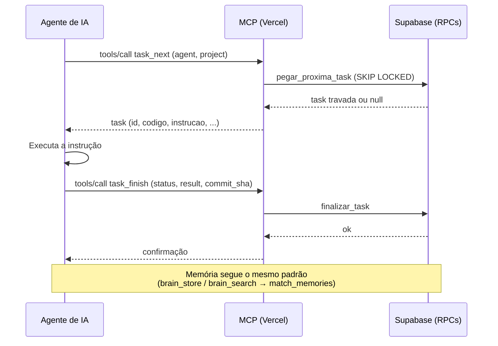

# DashboardAI


Gerenciador **genérico e multi-projeto** de tasks para agentes de IA. Qualquer projeto
pode cadastrar a sua fila de tarefas, que agentes (Claude Code, Codex, Grok, Gemini etc.)
consomem com segurança via **MCP**, com travas atômicas, dependências entre tasks,
registro de execução e uma **memória persistente** (busca semântica com pgvector)
compartilhada entre os agentes. Um painel web (React) mostra a fila, os logs, a memória e
a saúde das travas de cada projeto.

## Sumário

- [Arquitetura](#arquitetura)
- [Execução local](#execução-local)
- [Banco de dados](#banco-de-dados)
- [Deploy na Vercel](#deploy-na-vercel)
- [Agentes de IA (fila via MCP)](#agentes-de-ia-fila-via-mcp)
- [Memória via MCP](#memória-via-mcp)
- [Backup do banco](#backup-do-banco)
- [Segurança](#segurança)
- [Monitor em tempo real](#monitor-em-tempo-real)
- [Classificação de tarefas (Laya Server + Opus)](#classificação-de-tarefas-laya-server--opus)
- [Validação](#validação)

## Arquitetura

O DashboardAI é composto por três camadas principais que trabalham juntas para oferecer uma fila de tarefas segura para agentes de IA, memória semântica persistente e um painel de monitoramento.

### Frontend (SPA)
- **Stack:** React 19 + Vite + TypeScript + Tailwind CSS v4
- Localizado em `src/`
- Acessa o Supabase apenas com a chave **anon** + sessão do usuário (RLS aplicada)
- Principais áreas: Fila de Tarefas, Projetos, Cérebro de Memória, Logs, Monitor em tempo real e Configurações
- Autenticação via Supabase Auth (login com e-mail e senha ou link mágico) e cadastro pelo link
  **Criar usuário** da tela de login (ver [Cadastro de usuários](#4-cadastro-de-usuários-criar-usuário))

### Backend serverless (Vercel)
- `api/mcp.ts`: servidor **MCP** (Model Context Protocol) via Streamable HTTP / JSON-RPC 2.0
  - Ferramentas de fila: `task_next`, `task_finish`, `task_list`, `task_create`
  - Ferramentas de memória: `brain_store`, `brain_search`, `brain_delete`
  - Ferramentas de eventos: `agent_event`
  - Autenticação: `Authorization: Bearer <MCP_AUTH_TOKEN>`
- `api/embedding.ts`: endpoint autenticado (JWT da sessão Supabase) que gera embeddings no servidor (nunca expõe a chave da OpenAI no navegador)

### Banco de dados (Supabase)
- PostgreSQL 15+ com extensão **pgvector**
- Multi-projeto (`projects`, `project_members`, papéis viewer/editor/owner + admin global)
- Tabelas principais: `tasks`, `ai_memories` (embeddings 1536 dim), `agendamento_tarefa_logs`, `agent_events`, `agent_messages`, `project_rules`
- **RLS** rigoroso: o navegador só vê o que o usuário tem permissão; agentes usam `service_role` no servidor
- RPCs principais (security definer, só `service_role`):
  - `pegar_proxima_task` (captura atômica com `SKIP LOCKED`)
  - `finalizar_task` / `liberar_trava_task`
  - `match_memories` (busca por similaridade de cosseno)
  - `ler_recados` / `conferir_regras`

### Scripts
- `scripts/sincronizar_tasks.py`: sincroniza o quadro Markdown ↔ banco
- `database/`: scripts SQL idempotentes (00–07)
- `database/tests/`: testes de RLS, fila, memória e concorrência

### Fluxo principal (Agente → MCP → Banco)



O frontend consome as mesmas tabelas via chave anon + RLS, enquanto o MCP e os scripts usam a `service_role` exclusivamente no servidor.

## Execução local

### Pré-requisitos

- **Node.js 22.12+** (o `package.json` exige `"engines": { "node": ">=22.12" }`). O
  [`.nvmrc`](.nvmrc) fixa a versão 22: com o nvm, rode `nvm use` na raiz.
- **npm** (vem com o Node). Use `npm ci`, que respeita o `package-lock.json`.
- Opcional: **Python 3** para os scripts de [`scripts/`](scripts/) e os testes deles.
- Opcional, só para os testes de integração: **PostgreSQL** com `pgvector` e **PostgREST**
  locais (ver abaixo).

### Passo a passo

```bash
nvm use                      # Node 22 (lê o .nvmrc)
npm ci                       # instala as dependências exatas do package-lock.json
cp .env.example .env.local   # frontend (Vite); use `.env` para api/ e scripts/
npm run check:env            # confere se toda variável usada no código está no .env.example
npm run dev                  # Vite em http://localhost:5173
```

Preencha no `.env.local` ao menos `VITE_SUPABASE_URL` e `VITE_SUPABASE_ANON_KEY` (chave
**anon**, nunca a `service_role`). As variáveis sem prefixo `VITE_` são do servidor
(`api/` e `scripts/`) e ficam no `.env`; o [`.env.example`](.env.example) explica cada uma.
Os dois arquivos estão no `.gitignore`.

> O `npm run dev` sobe **só o frontend** (Vite). As funções de [`api/`](api/) (MCP e
> embeddings) rodam na Vercel — veja [Deploy na Vercel](#deploy-na-vercel).

### Desenvolvimento local com Supabase (opcional)

Dá para rodar **o Supabase inteiro na sua máquina**, em contêineres Docker — sem custo e sem tocar no
banco de produção. Guia completo (instalação, portas, problemas comuns): [`docs/supabase-local.md`](docs/supabase-local.md).

**Pré-requisitos:** **Docker Desktop** instalado e rodando, e o **Supabase CLI**, que já vem como
dependência de desenvolvimento do projeto (por isso se usa com `npx`, sem instalar nada global).

**Subir, conferir e parar** — todo comando leva `--workdir database/configlocal`, porque a
configuração local mora nessa pasta:

```bash
npx supabase --workdir database/configlocal start    # sobe os contêineres (1ª vez baixa as imagens)
npx supabase --workdir database/configlocal status   # portas e chaves locais
npx supabase --workdir database/configlocal stop     # para os contêineres
```

Studio em <http://localhost:54323>, API em `http://localhost:54321` e banco em `localhost:54322`.

**Alternar entre local e nuvem** — o `.env.local` liga o local; o `.env` tem as credenciais da nuvem:

| Comando | Ambiente |
|---|---|
| `npm run dev:local` | **Local** — cria/ativa o `.env.local` a partir do [`.env.local.example`](.env.local.example) e sobe o Vite |
| `npm run dev` | **Nuvem** — guarda o `.env.local` como `.env.local.off` e sobe o Vite |

**Quando usar cada um:** **local** para desenvolver e testar (dados descartáveis, funciona offline e
não custa nada); **nuvem** para produção/staging (dados reais e persistentes). As chaves locais são de
demonstração e **não** servem para o projeto da nuvem — nem o contrário.

### Scripts do `package.json`

| Comando | O que faz |
|---|---|
| `npm run dev` | Servidor de desenvolvimento do Vite (porta 5173) |
| `npm run build` | `tsc -b` + `vite build` (saída em `dist/`) |
| `npm run preview` | Serve o `dist/` gerado pelo build |
| `npm run typecheck` | Checagem de tipos do frontend e de `api/` |
| `npm run typecheck:api` / `typecheck:worker` | Checagem só de `api/` ou só do `worker/` |
| `npm test` | Testes unitários (`vitest run`), sem banco nem rede |
| `npm run test:integration` | Testes de integração contra PostgreSQL + PostgREST locais |
| `npm run check:env` | Variáveis usadas no código × `.env.example` |
| `npm run check:chunks` | Tamanho dos chunks do build (limite `CHUNK_LIMITE_KB`, padrão 500) |
| `npm run validar` | Validação completa (ver abaixo) |
| `npm run worker` | Worker LangGraph (`tsx worker/index.ts`) |
| `npm run sync:agentes` | Copia as skills de `.agents/` para `.claude/` e `.grok/` e gera `.gemini/commands/` |
| `npm run check:agentes` | Só confere as cópias das skills (falha se alguma estiver desatualizada) |

### Testes

```bash
npm test                     # unitários (vitest)
npm run test:integration     # integração (precisa de banco local)
```

O `npm run test:integration` roda [`tests/integration/run.sh`](tests/integration/run.sh): recria
o banco local `dashai_front_test` com os scripts de `database/`, sobe um PostgREST temporário e
roda `vitest run tests/integration`. Precisa do `psql` (por padrão `sudo -n -u postgres psql`;
troque com `PSQL=...`) e do binário do PostgREST (`POSTGREST_BIN=/caminho/postgrest`). Também
aceita `DB` e `PORT`. ⚠️ **Nunca** rode contra o Supabase: o script apaga e recria o banco.

### Validação completa

```bash
npm run validar
```

O [`scripts/validar.sh`](scripts/validar.sh) roda, **sem parar na primeira falha**: `typecheck`,
`npm test`, `build`, `check:chunks`, `check:env`, os testes Python
(`python3 -m unittest discover -s scripts`, pulados sem `python3`) e
`npm audit --omit=dev --audit-level=high`. No fim mostra um resumo e sai com código 1 se
alguma etapa falhou.

## Banco de dados

O banco é um projeto **Supabase** (PostgreSQL 15+ com a extensão `pgvector` ≥ 0.5). Os scripts
ficam em [`database/`](database/README.md) e são **idempotentes**: podem ser reaplicados sem erro
e sem perda de dados (também atualizam instalações antigas). A descrição completa de tabelas,
funções, papéis e RLS está no [`database/README.md`](database/README.md).

### 1. Aplicar os scripts

Aplique **em ordem numérica** (`00` → `08`):

| Arquivo | Conteúdo |
|---|---|
| `00_projects_roles.sql` | Projetos (`projects`), papéis globais (`user_roles`) e por projeto (`project_members`) |
| `01_tasks_schema.sql` | Fila `tasks` (código por projeto, dependências, triggers de guarda) |
| `02_logs_schema.sql` | Histórico de execuções dos agentes |
| `03_memories_schema.sql` | `pgvector` + memórias (`ai_memories`) por projeto ou globais |
| `04_rpc_functions.sql` | `pegar_proxima_task`, `finalizar_task`, `liberar_trava_task`, `match_memories` etc. |
| `05_rls_policies.sql` | RLS e permissões das tabelas e funções de 00–04 |
| `06_messages_rules.sql` | Recados entre agentes e regras por projeto |
| `07_agent_events.sql` | Eventos dos agentes para o monitor em tempo real |
| `08_projects_campos.sql` | Responsável, prazo, cor, ícone, URLs, prioridade e tags do projeto |

- **SQL Editor do Supabase:** abra cada arquivo, cole e execute, na ordem da tabela.
- **psql** (use a *connection string* do painel do Supabase, em *Project Settings > Database*):

```bash
export DATABASE_URL='postgresql://postgres:<senha>@<host>:5432/postgres'
for f in database/0*.sql; do psql "$DATABASE_URL" -v ON_ERROR_STOP=1 -f "$f"; done
```

- **Local (Docker):** os mesmos scripts existem como **migrations** em
  [`database/configlocal/supabase/migrations/`](database/configlocal/supabase/migrations/) e são
  aplicadas por `npx supabase --workdir database/configlocal db reset` — veja
  [Desenvolvimento local com Supabase](#desenvolvimento-local-com-supabase-opcional). Mudou um script?
  Atualize as **duas cópias** ([`database/README.md`](database/README.md) explica).

### 2. Criar o projeto e os membros

O script `00` já cria o projeto `default`. Para outro projeto e a sua equipe (SQL Editor, como
`postgres`; os `user_id` vêm de *Authentication > Users*):

```sql
-- Primeiro administrador global (vê e gerencia todos os projetos)
insert into public.user_roles (user_id, role) values ('<auth.users.id>', 'admin')
on conflict (user_id) do update set role = 'admin';

-- Novo projeto: slug em minúsculas; prefixo do código das tasks (MEUAPP-0001)
insert into public.projects (slug, nome, prefixo_codigo)
values ('meu-app', 'Meu App', 'MEUAPP')
on conflict (slug) do nothing;

-- Membros do projeto: owner > editor > viewer
insert into public.project_members (project_id, user_id, role)
select id, '<auth.users.id>', 'editor' from public.projects where slug = 'meu-app'
on conflict (project_id, user_id) do update set role = excluded.role;
```

| Papel | O que pode |
|---|---|
| `viewer` | Lê a fila, os logs e as memórias do projeto |
| `editor` | Também cria e edita tasks e memórias do projeto |
| `owner` | Também edita o projeto, a equipe e as regras |
| `admin` (global, `user_roles`) | Tudo, em todos os projetos |

O cadastro e a lista ficam em [`#/projetos`](#/projetos), no menu **Projetos**. Administradores
criam projetos; o responsável (owner) ou um administrador pode editar e ativar/inativar. O status
continua sendo `projects.ativo` (boolean), exibido como **1-ATIVO** ou **0-INATIVO**. Toda task já
pertence a um projeto pelo campo obrigatório `tasks.project_id`. Para os novos campos da tabela
`projects`, aplique também `database/08_projects_campos.sql` conforme a ordem acima.

Agentes, MCP e scripts usam a chave `service_role` no servidor (ignora a RLS); o navegador usa
só a chave anon com o login do usuário.

### 3. Testar localmente

`database/tests/run_tests.sh` cria o banco `dashai_test` num PostgreSQL **local** com pgvector,
simula os papéis do Supabase, aplica `00`–`06` duas vezes (idempotência) e roda as verificações
de RLS, fila, memória, recados/regras e captura paralela de tasks:

```bash
database/tests/run_tests.sh                                   # usa `sudo -u postgres psql`
PSQL="psql -h localhost -U postgres" database/tests/run_tests.sh
```

> ⚠️ Nunca rode os testes contra o Supabase: o script **apaga e recria** o banco de teste.

### 4. Cadastro de usuários ("Criar usuário")

A tela de login tem o link **Não tem conta? Criar usuário**, que abre o formulário de cadastro
(nome, e-mail, senha e confirmação) e usa o `signUp` do Supabase Auth. O usuário criado não ganha
papel nenhum: o acesso vem dos `project_members` (ou de `user_roles`, gravado por um administrador;
o primeiro administrador é criado no SQL Editor, ver [`database/README.md`](database/README.md#primeiro-administrador-e-membros)).

Configuração necessária no painel do Supabase:

- **Authentication → Providers → Email:** cadastro de novos usuários **habilitado** e
  **"Confirm email" ligado** (recomendado, para só entrar quem tem acesso à caixa de entrada).
- **Authentication → URL Configuration:** em *Site URL* e *Redirect URLs*, a URL do dashboard
  (local e de produção), para o link de confirmação voltar para a tela certa.

## Deploy na Vercel

### 1. Configurar o projeto na Vercel

1. Importe o repositório do GitHub na Vercel
2. Configure o **Node.js Version** como `22.x` (ou `22.12+` conforme `.nvmrc`)
3. Configure o **Framework Preset** como `Vite` (o `vercel.json` já define as funções)

### 2. Variáveis de ambiente

Configure as seguintes variáveis no painel da Vercel (*Settings > Environment Variables*):

| Variável | Valor | Observação |
|----------|-------|------------|
| `SUPABASE_URL` | URL do projeto Supabase | Ex: `https://xxxxx.supabase.co` |
| `SUPABASE_SERVICE_ROLE_KEY` | Chave service_role do Supabase | **Só servidor**, nunca no Git |
| `OPENAI_API_KEY` | Chave da OpenAI (embeddings) | **Só servidor**, nunca no Git |
| `MCP_AUTH_TOKEN` | Token de autenticação do MCP | Gere com `openssl rand -hex 32` |
| `MCP_DEFAULT_PROJECT` | Slug do projeto padrão | Ex: `default` |
| `MCP_ALLOWED_PROJECTS` | (opcional) Slugs permitidos | Ex: `meu-app,outro-app` |
| `LANGGRAPH_DATABASE_URL` | Connection string Postgres | Para checkpointer do worker (opcional) |
| `WORKER_MODELO` | Modelo do worker LangGraph | Ex: `gpt-4o-mini` (opcional) |
| `WORKER_MODELO_LEVE` / `_MEDIO` / `_PESADO` | Modelo do planejamento por nível da task (SUB-47.19); vazio usa `WORKER_MODELO`; task sem nível usa o do `MEDIO` | Opcional |

**Variáveis do frontend** (bundle, começam com `VITE_`):

| Variável | Valor | Observação |
|----------|-------|------------|
| `VITE_SUPABASE_URL` | URL do projeto Supabase | A mesma do servidor |
| `VITE_SUPABASE_ANON_KEY` | Chave anon do Supabase | Pública por definição |

⚠️ **Nunca** use prefixo `VITE_` para segredos do servidor (eles vazariam no bundle).

### 3. Limits e timeouts

Configurado no `vercel.json` (já definido), por função:

```json
{
  "functions": {
    "api/mcp.ts": {
      "maxDuration": 30
    },
    "api/embedding.ts": {
      "maxDuration": 15
    }
  }
}
```

- `api/mcp.ts`: até 30s por chamada; `api/embedding.ts`: até 15s.
- Funções sem entrada no `vercel.json` usam o padrão do plano.
- Se precisar de mais tempo, aumente o `maxDuration` da função no `vercel.json`, dentro do limite do plano.
- Limites da Vercel com Fluid compute (ativado por padrão em projetos novos), conferidos em 2026-10-12 em [Configuring Maximum Duration](https://vercel.com/docs/functions/configuring-functions/duration):
  - Hobby: padrão e máximo de 300s;
  - Pro e Enterprise: padrão de 300s e máximo de 800s.

### 4. Rewrite e roteamento

O `vercel.json` já configura o rewrite `/mcp` → `/api/mcp`:

```json
{
  "rewrites": [
    { "source": "/mcp", "destination": "/api/mcp" }
  ]
}
```

Apos o deploy, o endpoint MCP estará em:
- `https://<seu-app>.vercel.app/mcp` (rewrite)
- `https://<seu-app>.vercel.app/api/mcp` (direto)

### 5. Deploy

- Habilite a integração com GitHub
- Configure o **Build Command**: `npm run build`
- Configure o **Output Directory**: `dist`
- O deploy é automático ao fazer push para `main`

### 6. Validar após o deploy

```bash
# Conferir MCP
curl -s https://<seu-app>.vercel.app/mcp \
  -H "Authorization: Bearer $MCP_AUTH_TOKEN" \
  -H 'Content-Type: application/json' \
  -d '{"jsonrpc":"2.0","id":1,"method":"tools/list"}'

# Conferir embeddings (com JWT de sessão)
curl -s https://<seu-app>.vercel.app/api/embedding \
  -H "Authorization: Bearer <JWT_SESSION_TOKEN>" \
  -H 'Content-Type: application/json' \
  -d '{"text":"teste"}'
```

### 7. Worker LangGraph (opcional)

Para executar o worker (SUB-28):

```bash
# Local (com .env.local)
npm run worker -- --projeto default --agente "Worker Teste"

# Em produção (Vercel ou outro servidor)
# Configure as variáveis do worker e rode o comando
node --max-old-space-size=2G worker/index.ts -- --projeto default --agente "Worker Prod"
```

**Variáveis do worker:**
- `OPENAI_API_KEY`: obrigatório para o modelo
- `LANGGRAPH_DATABASE_URL`: obrigatório para checkpointer durável
- `WORKER_MODELO`: opcional (padrão `gpt-4o-mini`)
- `WORKER_MODELO_LEVE`, `WORKER_MODELO_MEDIO`, `WORKER_MODELO_PESADO`: opcionais, modelo por nível
  da task (`tasks.nivel_tarefa`); vazios usam o `WORKER_MODELO`

## Agentes de IA (fila via MCP)

Os agentes se conectam ao endpoint `/mcp` com o token `MCP_AUTH_TOKEN` e usam as
ferramentas da fila (`task_next`, `task_finish`, `task_list`, `task_create`, em
[`api/_lib/queue-tools.ts`](api/_lib/queue-tools.ts)) para pegar, executar e finalizar tasks
do projeto, sempre respeitando travas e dependências.

### Configurar o cliente MCP

O servidor ([`api/mcp.ts`](api/mcp.ts)) usa o transporte **Streamable HTTP** (JSON simples, sem
SSE), protocolos `2025-06-18`, `2025-03-26` e `2024-11-05`, e responde só a `POST`:

- **URL:** `https://<seu-app>.vercel.app/mcp` (rewrite para `/api/mcp`, no `vercel.json`).
- **Autenticação:** cabeçalho `Authorization: Bearer <MCP_AUTH_TOKEN>`. Sem `MCP_AUTH_TOKEN`
  no servidor, as ferramentas de fila e memória ficam **desativadas**; com ele, um token
  errado ou ausente recebe `401`. Guarde o token numa variável de ambiente do cliente, nunca
  no repositório.
- **Projeto:** cada ferramenta aceita o argumento `project` (slug); sem ele vale
  `MCP_DEFAULT_PROJECT`. Para dar a um projeto um endpoint/token só dele, faça um deploy com
  `MCP_ALLOWED_PROJECTS=meu-app` (outros slugs e memória global são recusados).

**Claude Code:** o [`.mcp.json`](.mcp.json) da raiz já registra o servidor `dashboard-ai`
para quem abrir o projeto. Basta exportar, antes de abrir o Claude Code,
`DASHBOARD_AI_MCP_URL` (ex.: `https://<seu-app>.vercel.app/mcp`) e `MCP_AUTH_TOKEN`; sem elas o
servidor só aparece como desconectado. Para registrar à mão, fora do projeto:

```bash
claude mcp add --transport http dashboard-ai https://<seu-app>.vercel.app/mcp \
  --header "Authorization: Bearer $MCP_AUTH_TOKEN"
```

**Codex** (`~/.codex/config.toml` ou `.codex/config.toml` do projeto; o token vem da variável
de ambiente `MCP_AUTH_TOKEN` exportada antes de abrir o Codex):

```toml
[mcp_servers.dashboard-ai]
url = "https://<seu-app>.vercel.app/mcp"
bearer_token_env_var = "MCP_AUTH_TOKEN"
```

Ou: `codex mcp add dashboard-ai --url https://<seu-app>.vercel.app/mcp --bearer-token-env-var MCP_AUTH_TOKEN`.

**Outros clientes** com suporte a MCP via HTTP (Cursor, Gemini CLI etc.): informe a mesma URL
e o cabeçalho `Authorization` no formato de configuração de cada um, por exemplo:

```json
{ "mcpServers": { "dashboard-ai": {
  "url": "https://<seu-app>.vercel.app/mcp",
  "headers": { "Authorization": "Bearer ${MCP_AUTH_TOKEN}" } } } }
```

**Conferir a conexão** (deve listar `task_next`, `task_finish`, `task_list`, `task_create`,
`brain_store`, `brain_search` e `brain_delete`):

```bash
curl -s https://<seu-app>.vercel.app/mcp \
  -H "Authorization: Bearer $MCP_AUTH_TOKEN" -H 'Content-Type: application/json' \
  -d '{"jsonrpc":"2.0","id":1,"method":"tools/list"}'
```

**Protocolo de trabalho:** além da fila no banco, agentes que trabalham **neste repositório**
seguem o [`AGENTS.md`](AGENTS.md), que aponta as regras em [`.claude/rules/`](.claude/rules/INDEX.md).
O quadro é o [`tasks/STATUS.md`](tasks/STATUS.md): uma linha por subtarefa, que qualquer IA reserva
na coluna "Em uso por" (commit + push imediatos antes de codar, no máximo 1 subtarefa por frente,
nunca mexer na reserva de outra); a etapa de cada tarefa, em [`tasks/etapas/`](tasks/etapas/), guarda
plano, descrição e entrega. O quadro antigo e as concluídas até 2026-10-13 estão em
[`tasks/historico/`](tasks/historico/README.md). O passo a passo está na skill
[`proxima-task`](.agents/skills/proxima-task/SKILL.md). A raiz `/` é o **app React** (entry do Vite em `index.html` → `src/main.tsx`); o painel do quadro é [`public/painel.html`](public/painel.html) (servido em `/painel.html`) e lê o quadro e o histórico.

### Comandos (skills) em cada IA

A fonte única das skills é [`.agents/skills/`](.agents/skills/) (padrão aberto `SKILL.md`). Para
criar ou mudar uma skill, edite só ali e rode `npm run sync:agentes`; o `pre-push` recusa o push se
as cópias estiverem desatualizadas.

| Ferramenta | Onde lê | Como chamar |
|---|---|---|
| Codex | `.agents/skills/` (fonte) | `$proxima-task` ou `/skills` |
| Google Antigravity | `.agents/skills/` (fonte) | `/proxima-task` |
| Cursor | `.agents/skills/` (fonte) | `/proxima-task` |
| GitHub Copilot (VS Code) | `.agents/skills/` (fonte) | `/proxima-task` |
| Claude Code | `.claude/skills/` (cópia) | `/proxima-task` |
| Grok Build | `.grok/skills/` (cópia) | `/proxima-task` |
| Gemini CLI | `.gemini/commands/proxima-task.toml` (gerado) | `/proxima-task` |
| Outras (DeepSeek, Devin, OpenRouter) | sem formato de comando | "siga a skill `proxima-task`" |

### Ciclo da fila (exemplos)

Todas as chamadas são `tools/call` (JSON-RPC 2.0) com o nome da ferramenta em `params.name`.
O argumento `project` (slug) é opcional; sem ele vale `MCP_DEFAULT_PROJECT`.

**1. Pegar a próxima task** — `task_next` trava a task elegível de maior prioridade (dependências
concluídas, ON, `executar_apos` alcançado, tentativas sobrando) para o agente:

```json
{ "jsonrpc": "2.0", "id": 1, "method": "tools/call",
  "params": { "name": "task_next", "arguments": {
    "agent": "Claude Code", "project": "meu-app", "lock_minutes": 90, "routine": "agendador-ia" } } }
```

A resposta traz `task` (com `id`, `codigo`, `titulo`, `instrucao`, `dependencias`, `tentativas`
etc.) ou `task: null` com a fila vazia (com `routine`, grava um log `sem_tarefa`).
`exclusive: true` limita a 1 task em execução por projeto.

**2. Executar** a `instrucao` da task (código, commit, PR...).

**3. Finalizar** — `task_finish` com o `id` recebido libera a trava e grava o log. Use o mesmo
`agent` do `task_next` (confere o dono da trava):

```json
{ "jsonrpc": "2.0", "id": 2, "method": "tools/call",
  "params": { "name": "task_finish", "arguments": {
    "task_id": 42, "status": "concluida", "agent": "Claude Code", "routine": "agendador-ia",
    "result": "Implementado o filtro por data, com testes.",
    "pr_url": "https://github.com/minha-org/meu-app/pull/17", "commit_sha": "a1b2c3d",
    "metadata": { "repositorio": "minha-org/meu-app", "branch": "feat/filtro-data", "arquivos_alterados": 4 } } } }
```

```json
{ "jsonrpc": "2.0", "id": 3, "method": "tools/call",
  "params": { "name": "task_finish", "arguments": {
    "task_id": 43, "status": "recusada", "agent": "Claude Code",
    "result": "A instrução pede para apagar dados de produção; precisa de decisão humana." } } }
```

```json
{ "jsonrpc": "2.0", "id": 4, "method": "tools/call",
  "params": { "name": "task_finish", "arguments": {
    "task_id": 44, "status": "erro", "agent": "Claude Code",
    "result": "Build falhou: dependência indisponível.",
    "metadata": { "erro_mensagem": "npm ERR! 503 Service Unavailable" } } } }
```

| `status` | Quando usar | Efeito |
|---|---|---|
| `concluida` | Trabalho feito | Task concluída |
| `recusada` | Fere uma regra, está ambígua ou precisa de decisão humana (explique em `result`) | Task recusada, sai da fila |
| `erro` | Falha técnica | Volta para `pendente` se ainda houver tentativas (`tentativas`/`max_tentativas`); senão fica `erro` |

**Listar** — `task_list` devolve as tasks não excluídas na ordem da fila (filtro opcional de
`status`, `limit` 1–200, padrão 50; `include_instruction` traz instrução e resultado):

```json
{ "jsonrpc": "2.0", "id": 5, "method": "tools/call",
  "params": { "name": "task_list", "arguments": {
    "project": "meu-app", "status": ["pendente", "em_execucao"], "limit": 20 } } }
```

**Criar** — `task_create` (origem `mcp`); o código `<PREFIXO>-NNNN` é gerado se `code` for
omitido. `type: "humano"` cria etapas de pessoas, que agentes não pegam:

```json
{ "jsonrpc": "2.0", "id": 6, "method": "tools/call",
  "params": { "name": "task_create", "arguments": {
    "project": "meu-app", "title": "Testes do filtro por data",
    "instruction": "Cobrir com testes unitários o filtro por data da listagem.",
    "type": "ia", "priority": 2, "order": 10, "dependencies": ["MEUAPP-0042"],
    "execute_after": "2026-10-13T08:00:00-03:00", "max_attempts": 3 } } }
```

## Classificação de tarefas (Laya Server + Opus)

A equipe planeja classificar tarefas com o Laya Server local como primeira opção e usar o Opus como
revisor/fallback para decisões com score abaixo de `0.7` ou quando o Laya estiver indisponível. O
contrato e os passos para subir o serviço estão em [`docs/laya-server.md`](docs/laya-server.md).

O serviço local é iniciado com `scripts/start-laya.bat` e parado com `scripts/stop-laya.bat`.
O classificador híbrido do Dashboard ainda depende da conclusão da SUB-47.1; até lá, a configuração
do servidor não significa que a fila já classifica tarefas automaticamente.

## Memória via MCP

O servidor MCP (`/mcp`, código em [`api/_lib/brain-tools.ts`](api/_lib/brain-tools.ts)) oferece
uma **memória persistente** compartilhada entre os agentes: decisões, regras e aprendizados em
Markdown, gravados na tabela `ai_memories` com um embedding (1536 dimensões) e recuperados por
similaridade de cosseno (RPC `match_memories`, pgvector). Como as ferramentas da fila, exigem
`MCP_AUTH_TOKEN` no servidor (o cliente manda `Authorization: Bearer <token>`).

### Escopo: projeto ou global

- **Projeto:** argumento `project` (slug) → `MCP_DEFAULT_PROJECT` → `default`. O título é
  **único por projeto**: gravar de novo o mesmo título atualiza a memória (upsert).
- **Global** (`global: true`, `project_id` nulo): compartilhada por todos os projetos. Não pode
  ser combinada com `project` e é **recusada** quando o servidor está restrito por
  `MCP_ALLOWED_PROJECTS`.
- A busca do projeto inclui as globais por padrão (`include_global: true`).

### Ferramentas

| Ferramenta | Argumentos | O que faz |
|---|---|---|
| `brain_store` | `title` (obrigatório, ≤ 200), `content` (obrigatório, Markdown, ≤ 100.000), `tags` (≤ 20, cada ≤ 60, salvas em minúsculas), `project` ou `global` | Grava ou atualiza a memória (embedding de `título + conteúdo`) |
| `brain_search` | `query` (obrigatório, ≤ 8.000), `project`, `tags` (só memórias com **todas** as tags), `limit` (1–20, padrão 5), `threshold` (0 a < 1, padrão **0.5**), `include_global` (padrão `true`) | Busca semântica; cada resultado traz `title`, `scope` (`project`/`global`), `similarity` (3 casas), `tags`, `content` e `updated_at` |
| `brain_delete` | `title` ou `id` (UUID), `project` ou `global` | Remove a memória do projeto (ou das globais) |

**Limiar:** `threshold` é a similaridade mínima (1 − distância de cosseno). Sem resultados,
a resposta sugere outra consulta ou um limiar menor (ex.: `0.3`); para respostas mais
precisas, suba para `0.7`–`0.8`.

### Exemplos

Chamadas `tools/call` (JSON-RPC 2.0) ao endpoint `/mcp`:

```json
{ "jsonrpc": "2.0", "id": 1, "method": "tools/call",
  "params": { "name": "brain_store", "arguments": {
    "project": "meu-app",
    "title": "Padrão de datas na API",
    "content": "Toda data trafega em ISO 8601 UTC; a conversão para o fuso do usuário é só na interface.",
    "tags": ["api", "datas"] } } }
```

```json
{ "jsonrpc": "2.0", "id": 2, "method": "tools/call",
  "params": { "name": "brain_search", "arguments": {
    "project": "meu-app", "query": "como formatar datas no backend?",
    "tags": ["api"], "limit": 3, "threshold": 0.6 } } }
```

```json
{ "jsonrpc": "2.0", "id": 3, "method": "tools/call",
  "params": { "name": "brain_store", "arguments": {
    "global": true, "title": "Commits em português",
    "content": "Mensagens de commit no imperativo, em pt-BR.", "tags": ["git"] } } }
```

```json
{ "jsonrpc": "2.0", "id": 4, "method": "tools/call",
  "params": { "name": "brain_delete", "arguments": { "project": "meu-app", "title": "Padrão de datas na API" } } }
```

Com `curl` (o servidor exige `MCP_AUTH_TOKEN`):

```bash
curl -s https://<seu-app>.vercel.app/mcp \
  -H "Authorization: Bearer $MCP_AUTH_TOKEN" -H 'Content-Type: application/json' \
  -d '{"jsonrpc":"2.0","id":2,"method":"tools/call","params":{"name":"brain_search","arguments":{"project":"meu-app","query":"datas"}}}'
```

Boas práticas para agentes: **buscar antes de gravar** (`brain_search`) para não duplicar,
usar títulos descritivos e estáveis (o título é a chave), e apagar (`brain_delete`) memórias
obsoletas em vez de deixá-las contradizer as novas.

## Backup do banco

**Padrão: GitHub Artifacts ligado; Cloudflare R2 desligado.** Comparação, decisão e migração entre
os dois: [`docs/backup-database.md`](docs/backup-database.md).

Backup diário do Supabase local (02:00 UTC, 23:00 de Brasília) pelo workflow
[`backup-supabase-artifacts.yml`](.github/workflows/backup-supabase-artifacts.yml), publicado como
GitHub Artifact por 30 dias. Como o repositório é **público**, o dump sai **criptografado** e só é
gerado com o secret `SUPABASE_BACKUP_PASSPHRASE` (≥ 20 caracteres) — guarde a senha fora do GitHub.
Configuração, download, restauração, retenção e limites:
[`docs/backup-github-artifacts.md`](docs/backup-github-artifacts.md).
Para guardar mais de 90 dias, há o workflow alternativo no **Cloudflare R2** (desligado por
padrão, liga pela variável `SUPABASE_BACKUP_R2_ENABLED`):
[`docs/backup-cloudflare-r2.md`](docs/backup-cloudflare-r2.md).

## Segurança

### Chaves: o que vai para o navegador e o que fica no servidor

| Chave / variável | Onde | Observação |
|---|---|---|
| `VITE_SUPABASE_URL`, `VITE_SUPABASE_ANON_KEY` | Navegador (bundle) | Públicas por definição. `getSupabase()` recusa uma chave cujo JWT tenha `role = service_role`. |
| `SUPABASE_SERVICE_ROLE_KEY` | Só servidor (`api/`, scripts) | Ignora a RLS. Nunca com prefixo `VITE_`, nunca no Git. |
| `OPENAI_API_KEY` (embeddings) | Só servidor (`api/embedding.ts`, MCP) | O frontend chama `/api/embedding` com o JWT do usuário; erros do provedor não são devolvidos (podem ecoar a chave). |
| `MCP_AUTH_TOKEN` | Só servidor + clientes MCP | Obrigatório: sem ele as ferramentas de dados do `/mcp` ficam desativadas. Gere com `openssl rand -hex 32`. |

Nenhum segredo vai para o Git: só o `.env.example`, com valores vazios (`.env` e `.env.local` estão no `.gitignore`).

### RLS por projeto e papéis (`database/05_rls_policies.sql`)

- **`anon`**: nenhum acesso a tabelas ou funções. Sem login, a interface não lê nada.
- **`authenticated`**: só os projetos em que é membro (`project_members`), ou todos se for administrador global (`user_roles.role = 'admin'`, função `eh_administrador()`):
  - `viewer` lê projeto, tasks, logs e memórias do projeto;
  - `editor` também cria e altera tasks e cria, altera e exclui memórias do projeto (sem `DELETE` em tasks: exclusão lógica; o trigger de guarda impede mexer em execução/trava);
  - `owner` também altera o projeto e gerencia `project_members`;
  - memória global (`project_id` nulo): qualquer autenticado lê, só administrador escreve;
  - logs: só leitura; quem grava é o backend.
- **`service_role`**: backend/agentes (MCP, scripts, worker). Ignora a RLS e é o único que executa as funções da fila (`pegar_proxima_task`, `finalizar_task`, `liberar_trava_task`, ...) e `match_memories`.

### Login

- O dashboard exige sessão do Supabase Auth: sem sessão a `RotaProtegida` mostra o login (SUB-27.13). Configuração do provedor e das URLs de retorno em [`src/README.md`](src/README.md#autenticação-supabase-auth) (SUB-27.17).
- O link mágico usa `shouldCreateUser: false`: só entra quem já foi cadastrado. O primeiro administrador e os membros são criados como descrito em [`database/README.md`](database/README.md) (SUB-27.21).
- `sair()` encerra a sessão e esquece o projeto selecionado no navegador.

### Rotação de chaves

1. **`MCP_AUTH_TOKEN`**: gere um novo, atualize na Vercel (*Settings → Environment Variables*), faça *redeploy* e troque nos clientes MCP. O token antigo deixa de valer no deploy.
2. **`SUPABASE_SERVICE_ROLE_KEY` / anon**: no Supabase, *Project Settings → API* (ou *API Keys*), gere novas chaves/rotacione o JWT secret; atualize Vercel (`SUPABASE_*` e `VITE_SUPABASE_ANON_KEY`), scripts locais (`.env`) e faça *redeploy*. Rotacionar o JWT secret encerra todas as sessões.
3. **`OPENAI_API_KEY`**: crie uma nova no provedor, atualize na Vercel, *redeploy* e revogue a antiga.
4. Se uma chave vazou no Git, rotacione primeiro; reescrever o histórico do Git é opcional e não substitui a rotação.

## Monitor em tempo real

O monitor (SUB-35) mostra agentes ativos, eventos recentes e o estado da fila em tempo real via Supabase Realtime.

## Validação

A validação completa do projeto (`npm run validar`) garante que:
- O TypeScript compila sem erros (`tsc -b` para frontend e `api/`)
- Todos os testes unitários passam (`vitest run`, sem banco nem rede)
- O build de produção gera a pasta `dist/` sem alertas impeditivos
- Os chunks do build respeitam o limite de tamanho (padrão 500 kB)
- Todas as variáveis usadas no código estão documentadas no `.env.example`
- Os testes Python dos scripts passam (pulados sem `python3`)
- Não há vulnerabilidades de alta severidade nas dependências (`npm audit`)

O resultado da validação é registrado em [`docs/VALIDACAO.md`](docs/VALIDACAO.md), incluindo:
- Validação local (scripts `scripts/validar.sh`)
- Testes rápidos no banco de produção (telas Fila, Logs, Memória e Configurações)

Para detalhes do processo de validação, veja [`tasks/historico/docs/validacao-telas-producao.md`](tasks/historico/docs/validacao-telas-producao.md).

---

Coordenação entre agentes neste repositório: veja [`AGENTS.md`](AGENTS.md). Licença:
[`LICENSE`](LICENSE).
