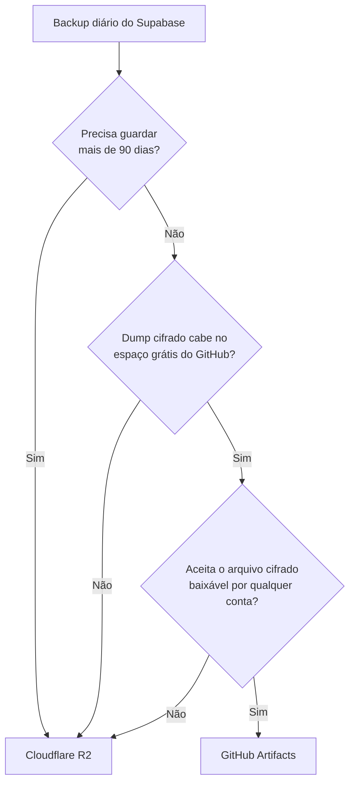

# 🗄️ Backup do banco: qual opção usar

Duas opções, com o mesmo dump do Supabase local **criptografado** (AES-256, senha do secret
`SUPABASE_BACKUP_PASSPHRASE`) e o mesmo horário (02:00 UTC, 23:00 de Brasília). **O projeto vem
com o GitHub Artifacts ligado**; o Cloudflare R2 vem desligado.

- [GitHub Artifacts](backup-github-artifacts.md) — `backup-supabase-artifacts.yml`
- [Cloudflare R2](backup-cloudflare-r2.md) — `backup-supabase-r2.yml`

## Comparação

| | GitHub Artifacts | Cloudflare R2 |
|---|---|---|
| Vem ligado? | Sim | Não (variável `SUPABASE_BACKUP_R2_ENABLED`) |
| Retenção | Até 90 dias (repositório público); o workflow usa 30 | Sem limite: você define pela regra de ciclo de vida |
| Espaço grátis | 500 MB em repositório privado (plano Free); público: ver doc | 10 GB-mês |
| Download | Grátis | Grátis |
| Quem consegue baixar | Qualquer conta do GitHub (repositório público) | Só quem tem o token do bucket |
| Configuração | 2 secrets | 6 secrets + bucket + token na Cloudflare |
| Custo acima do grátis | Cobrança de armazenamento do GitHub | US$ 0,015 por GB-mês |

Nos dois o arquivo só abre com a senha, mas no R2 nem o arquivo cifrado fica à vista.

## Como decidir



Dá para usar **os dois ao mesmo tempo**: Artifacts para os últimos dias (sem configurar nada além
da senha) e R2 para o histórico longo.

## Ligar e desligar

| Quero | Faça |
|---|---|
| Ligar o R2 | Variável `SUPABASE_BACKUP_R2_ENABLED` = `true` (Settings → Secrets and variables → Actions → Variables) |
| Desligar o R2 | Apagar a variável ou pôr `false` |
| Desligar o Artifacts | Aba **Actions** → *Backup Supabase para GitHub Artifacts* → **⋯** → **Disable workflow** |
| Religar o Artifacts | Mesmo lugar → **Enable workflow** |
| Testar qualquer um | **Run workflow** (roda mesmo com o R2 desligado) |

## Migrar backups do Artifacts para o R2

Os arquivos já vêm cifrados com a mesma senha: é só copiar, sem abrir.

```bash
export AWS_ACCESS_KEY_ID=<Access Key ID> AWS_SECRET_ACCESS_KEY=<Secret Access Key>
export AWS_DEFAULT_REGION=auto
R2="https://<ACCOUNT_ID>.r2.cloudflarestorage.com"

# 1) Baixar os artifacts que ainda não expiraram (cada um vira uma pasta com o .gpg dentro)
gh run list --workflow backup-supabase-artifacts.yml --limit 30 \
    --json databaseId --jq '.[].databaseId' \
  | while read -r id; do gh run download "$id" --dir "artifacts/$id" || true; done

# 2) Enviar para o R2 numa pasta separada
aws s3 cp artifacts/ "s3://<bucket>/supabase/migrados/" --recursive --endpoint-url "$R2"

# 3) Conferir
aws s3 ls "s3://<bucket>/supabase/migrados/" --recursive --endpoint-url "$R2"
```

Execução sem artifact (falhou ou expirou) só gera um aviso do `gh run download` e é pulada.

## Custo real (exemplos)

| Cenário | Artifacts | R2 |
|---|---|---|
| Dump cifrado de 50 MB, 30 dias guardados (≈ 1,5 GB) | Privado: passa dos 500 MB grátis; público: não detalhado* | Grátis |
| 50 MB por dia, 1 ano guardado (≈ 18 GB) | Não dá (máximo 90 dias) | ≈ US$ 0,12 por mês |
| 10 GB guardados no total | — | Grátis (limite do plano) |

\* A documentação de cobrança do GitHub não detalha o armazenamento de artifacts em repositório
público; acompanhe pelo uso da conta (ver [Artifacts](backup-github-artifacts.md)).
